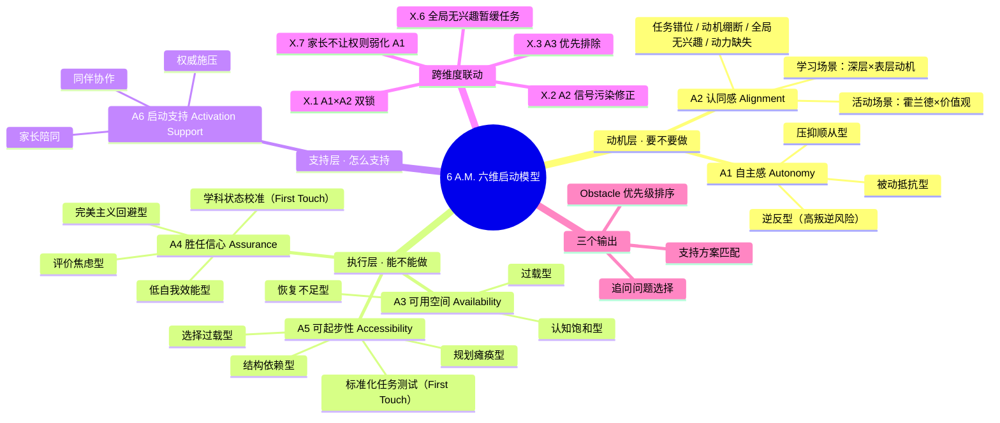
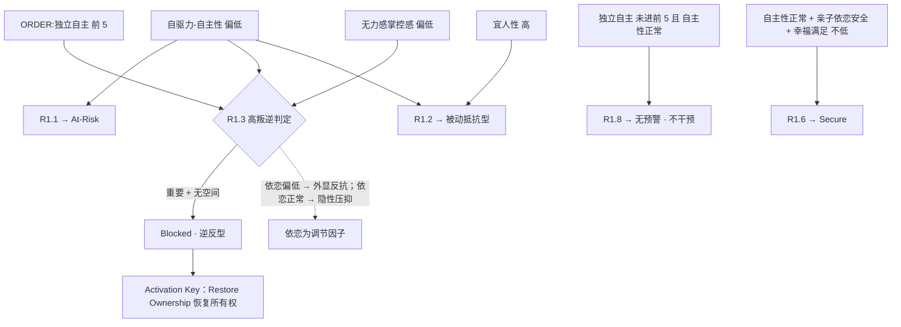
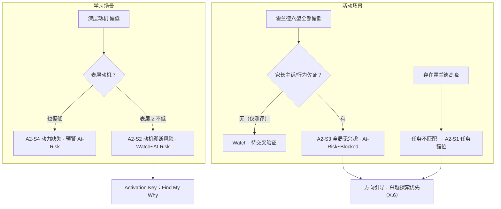
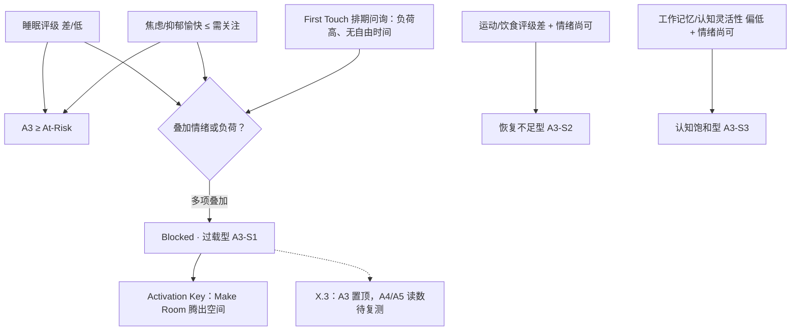
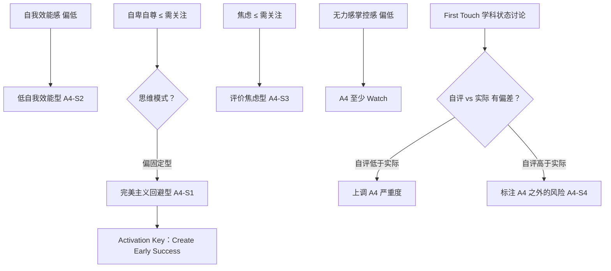
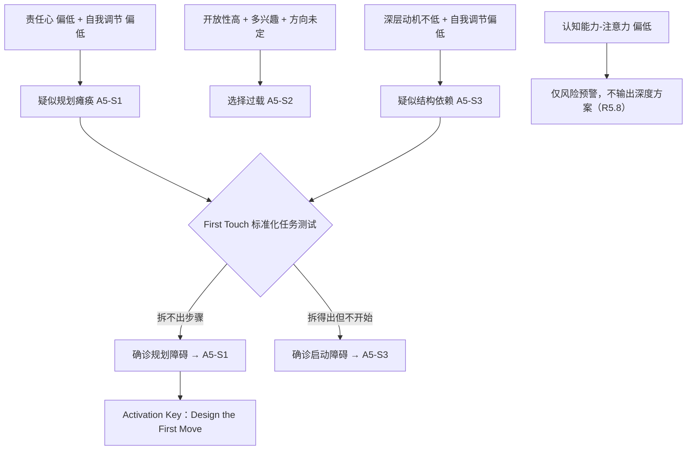
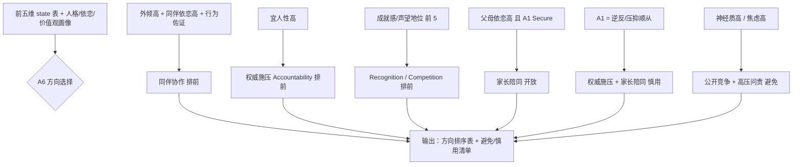

# 6 A.M. 六维启动模型 · 算法规格文档 v0.2

> 6 Activation Model — 找到学生愿意迈出第一步的那把钥匙
>
> 本文档是 `6 A.M..docx` 初步框架的**算法化升级版本**。
>
> **v0.2 修订说明**（依据会议纪要）：
> 1. 明确三层框架逻辑：A1–A2 动机层「要不要做」、A3–A5 执行层「能不能做」、A6 支持层「怎么支持」；
> 2. 证据来源从"仅 Y4 报告"扩展为四类：Y4 报告 / First Touch 会谈（问询 + 标准化任务）/ 家长诉求 / 顾问观察；
> 3. A1 高叛逆规则改写为两条件判定；A2 重构为双场景诊断（学习场景 / 活动场景）；A6 支持方向收敛为三类（同伴协作 / 权威施压 / 家长陪同）；
> 4. 新增「First Touch 会谈流程」章节（§7）；
> 5. 追问题库全部改写为面向初高中学生的口语版（§8）；
> 6. 新增 Mermaid 可视化：一张总览 mind map + 每维一张判定逻辑图。
>
> 文末「待定与待修订清单」（§11）中列出的位置，将在后续讨论稿确认后迭代。

---

## 0. 模型定位与设计原则

### 0.1 模型要回答的问题

> **What is stopping this student from starting?**
> 到底是什么挡住了学生迈出第一步？

6 A.M. 是针对青少年 Behavioral Activation（行为启动）建立的六维诊断与支持模型：

| 维度 | 名称 | 核心问题 | 所属层 |
|---|---|---|---|
| A1 | Autonomy 自主感 | 这是我想做的吗？ | 动机层 |
| A2 | Alignment 认同感 | 这件事对我有意义吗？ | 动机层 |
| A3 | Availability 可用空间 | 我现在还有空间做吗？ | 执行层 |
| A4 | Assurance 胜任信心 | 我相信自己做得到吗？ | 执行层 |
| A5 | Accessibility 可起步性 | 我知道第一步怎么走吗？ | 执行层 |
| A6 | Activation Support 启动支持 | 什么样的环境和支持能让我更容易开始？ | 支持层 |

**三层框架逻辑**：

- **动机层（A1–A2）解决「要不要做」**：学生想不想、认不认。
- **执行层（A3–A5）解决「能不能做」**：学生有没有资源、信心和路径。
- **支持层（A6）解决「怎么支持」**：谁、以什么方式出现，能让启动更容易发生。

六个问题共同决定学生能否跨过 **Knowing → Starting** 之间的距离。

### 0.2 四条设计原则

1. **State，不是 True/False。** 每个维度的输出不是一个是非答案，而是一组 state（含命名亚型）。同一个"自主感低"，在叛逆型学生和压抑顺从型学生身上，含义、风险和干预方式完全不同。
2. **测评指标是线索（clue），不是结论。** Y4 数据点用来形成假设（hypothesis），不能直接写成诊断。从假设到结论需要行为证据，行为证据来自 First Touch 会谈、标准化任务、家长诉求与对学生的直接追问（见 §8 追问题库）。
3. **维度之间是连通的。** A1 与 A2 相互耦合；A3、A4、A5 构成一条执行链条；A6 回头统筹前五维，决定"谁、以什么方式出现"。跨维度修正规则（X 规则）是模型不可缺少的一层。
4. **State 驱动三个产出：** ① obstacle 优先级排序；② 支持方式推荐；③ 追问问题选择。

---

## 1. 总体判定 Pipeline

```
四类证据源
  ├─ Y4 报告（测评分数 / 评级 / 排序）
  ├─ First Touch 会谈（维度问询 + 标准化任务测试 + 学科状态讨论）
  ├─ 家长诉求（如"孩子没兴趣、动力不足"类主诉）
  └─ 顾问观察（既往行为记录）
   │
   ▼
[1] 单维规则 R*.*        每个维度：证据 → 初始 state + 亚型 + confidence
   │
   ▼
[2] 跨维度修正规则 X.*    A1×A2 耦合 / A3→A4,A5 修正 / A6 统筹 / 特殊场景
   │
   ▼
[3] 最终 state 表         每维：state + 亚型 + confidence + 触发规则列表
   │
   ├─→ [4a] Obstacle Score 排序   → high-priority obstacle 列表与处理顺序
   ├─→ [4b] 支持方式映射           → 每维 Activation Key + A6 支持组合
   └─→ [4c] 追问问题选择           → Top-N 最该问学生的问题
```

### 1.1 规则书写格式

每条规则包含六个字段：

| 字段 | 说明 |
|---|---|
| 规则 ID | `R{维度}.{序号}`（单维规则）；`X.{序号}`（跨维度规则）；`Q{维度}.{序号}`（追问问题） |
| 触发条件 | 指标 + 档位条件（Y4 指标名与代码库中的原始命名一致） |
| 证据源 | 【Y4】测评报告；【FT】First Touch 会谈；【家长】家长诉求；【观察】顾问观察 |
| 产出 | state / 亚型 / confidence 修正 |
| 依据 | 该规则的心理学或行为逻辑 |
| 关联问题 | 用于验证该规则假设的追问问题 ID |

### 1.2 档位词约定

规则条件中使用的档位词均来自 Y4 评价体系的实际档位：

- **风险方向**：`需特殊关注`、`明显偏低`、`严重偏低`（严重级）；`偏低`、`需关注`（一般风险）
- **体质评级**：`差/低`（问题级）；`中等/一般`（关注级）
- **资产方向**：`高`、`较好`（强信号）；`不低`、`相对健康`、`正常`（中性偏健康）
- **排序项**：`ORDER:{值}` 命中 = 该值进入排序前 5 位

---

## 2. 状态体系

### 2.1 通用四级 State

| State | 含义 | 启动含义 |
|---|---|---|
| **Secure 稳固** | 证据显示该维度不构成启动障碍 | 不需要干预，可作为资源调用 |
| **Watch 关注** | 有弱信号或信号矛盾 | 不主动干预，但列入追问验证 |
| **At-Risk 风险** | 有较明确信号，很可能构成启动障碍 | 需要针对性支持设计 |
| **Blocked 阻塞** | 多个强信号相互印证，或单一严重信号 | high-priority obstacle，启动前必须先处理 |

一个维度的最终 state = 其触发规则中的最高严重级；仅有弱信号且互相矛盾时封顶为 Watch。

### 2.2 亚型（Subtype）

State 回答"有多严重"，亚型回答"是哪一种"。亚型决定支持方式的选择，也决定追问的方向。各维度的亚型定义见 §4。

### 2.3 Confidence 三级

| Confidence | 含义 |
|---|---|
| **Hypothesis** | 仅有 Y4 线索，未经任何行为证据验证 |
| **Supported** | 有行为证据佐证：First Touch 会谈观察、标准化任务表现、家长主诉、或顾问的既往行为记录（如"长期不启动某类任务"） |
| **Confirmed** | 已通过追问从学生处获得证实 |

设计意图：**confidence 低的 state 不是"不严重"，而是"该去问"**。它通过两个出口发挥作用：在优先级评分中降低权重（避免未验证假设盖过已证实问题）；在问题选择中提高被追问的优先级。

---

## 3. 维度总览

| 层 | 维度 | 核心问题 | 主要证据域 | 与其他维度的关系 |
|---|---|---|---|---|
| 动机层 | A1 Autonomy 自主感 | 这是我选择的吗？ | 自驱力-自主性、宜人性、亲子依恋、无力感掌控感、价值观排序 | 与 A2 耦合；影响 A6 支持方式合法性 |
| 动机层 | A2 Alignment 认同感 | 这对我有意义吗？ | 深层/表层动机（学习场景）、霍兰德六型、职业价值观（活动场景）、家长诉求 | 与 A1 耦合；其信号可能被 A1 污染（X.2） |
| 执行层 | A3 Availability 可用空间 | 我还有空间吗？ | 睡眠/饮食/运动评级、情绪稳定性、执行功能、First Touch 排期问询 | 链条起点：A3 不过载是 A4/A5 判读的前提（X.3） |
| 执行层 | A4 Assurance 胜任信心 | 我相信自己能做到吗？ | 无力感掌控感、自我效能感、自卑自尊、思维模式、First Touch 学科状态校准 | 被 A3 假性拉低；影响 A5 第一步的风险设计（X.4） |
| 执行层 | A5 Accessibility 可起步性 | 我知道第一步吗？ | 执行功能、责任心、自我调节、First Touch 标准化任务测试 | 链条末端：前五维全部过关后，任务才真正进入执行 |
| 支持层 | A6 Activation Support 启动支持 | 什么支持让我更容易开始？ | 外倾性、宜人性、依恋（父母/同伴）、成就相关价值观、日常行为描述 | 统筹者：读取前五维 state，输出支持组合 |

### 3.1 总览 Mind Map



---

## 4. 逐维规格

### 4.1 A1 Autonomy 自主感【动机层】

**核心问题：这是我要做的，还是别人要我做的？**

青少年阶段的核心发展任务之一是建立自主意识。一件事即使客观上有价值，只要学生感受到"这是别人安排给我的"，就可能出现启动阻力。有些学生不会直接拒绝——他们嘴上说"好，我知道了"，然后用不行动来表达拒绝。

**亚型定义**

| 亚型 | 名称 | 特征 |
|---|---|---|
| A1-S1 | Passive Resistance 被动抵抗型 | 表面配合、行为拒绝；不制造冲突，用拖延表达"不" |
| A1-S2 | Rebellion 逆反型（高叛逆风险） | 自主选择对学生重要，但当前没有自主选择空间；通过反抗权威来获取自主感 |
| A1-S3 | Suppressed Compliance 压抑顺从型 | 习惯被安排，不反抗，但也没有"这件事是我的"的主人翁感 |
| A1-S0 | （无亚型） | Secure 或证据不足以分型 |

**判定逻辑图**



**证据规则**

| 规则 ID | 触发条件 | 证据源 | 产出 | 依据 |
|---|---|---|---|---|
| R1.1 | `自驱力-自主性` = 偏低 | 【Y4】 | A1 ≥ At-Risk（Hypothesis） | 习惯从自身目标出发行动的程度低，是自主空间不足的核心信号 |
| R1.2 | R1.1 命中 且 `人格-宜人性` = 高/较好 | 【Y4】 | 亚型 → A1-S1 Passive Resistance | 高宜人性学生更易配合、不愿制造冲突，"表面答应、行为拒绝"风险升高；需验证（→Q1.1, Q1.2） |
| R1.3 | `ORDER:独立自主` 进前 5（**自主选择对学生重要**）且（`自驱力-自主性` = 偏低 或 `情绪稳定性-无力感掌控感` = 偏低及以下）（**当前无自主选择空间**） | 【Y4】 | 亚型 → A1-S2 Rebellion，state → Blocked（Hypothesis），标记**高叛逆风险人群** | 两条件同时满足即判定高叛逆风险：自主需求强 × 无自主空间 → 以反抗权威索取自主感（→Q1.3, Q1.4）。**亲子依恋为调节因子**：信任/沟通偏低 → 反抗外显化（顶撞、对着干）；依恋正常 → 反抗隐性化（消极、疏离） |
| R1.4 | R1.1 命中 且 `人格-宜人性` = 高/较好 且 亲子依恋三项均 ≥ 不低 | 【Y4】 | 亚型 → A1-S3 Suppressed Compliance | 关系安全但自主性低：学生不反抗，只是从未被要求"自己做主"（→Q1.5） |
| R1.5 | `情绪稳定性-无力感掌控感` = 偏低/需关注/需特殊关注 | 【Y4】 | A1 至少 Watch；与 R1.1 叠加时升一级 | 低掌控感提示学生感到生活安排主要由外界决定（→Q1.6） |
| R1.6 | `自驱力-自主性` = 较好/不低 且 亲子依恋（信任/沟通/亲近-父母）≥ 不低 且 `自我概念-幸福与满足` ≥ 不低 | 【Y4】 | A1 = Secure | 自主性高 + 亲子关系好 + 对现状满意 → 自主感自然稳固，且是针对整体生活而非单一任务 |
| R1.7 | 父母依恋差异显著（母亲与父亲同子项档位相差 ≥ 2 档） | 【Y4】 | 标记"支持来源不对称"，供 A6 使用 | 学生可能只接受一方父母的参与方式 |
| R1.8 | `ORDER:独立自主` 未进前 5 且 `自驱力-自主性` ≥ 不低 | 【Y4】 | **无特殊预警，无需额外干预** | 分层干预逻辑：自主需求低的人群对"被安排"不敏感，常规推进即可；选择权干预应集中投放在自主需求高的学生身上 |

**注意**：宜人性高不是低自主性的证明，只是"表面同意、行为拒绝"的线索；依恋数据不能直接说明自主感高低，它说明的是**学生在家庭关系中表达不同意见的难易度**。

**Activation Key：Restore Ownership 恢复所有权。** 提供有限选择、共同制定任务、允许修改目标、让学生参与决定 Why/What/How。**分层干预原则：对自主需求高的学生，后续规划尽量赋予选择权；对自主需求低的学生，无特殊预警，无需额外干预。** 对 A1-S2 逆反型：成人先公开让渡一部分决定权（包括说"不"的权利），再谈任务本身。特殊场景见 X.7（家长无法让渡主导权的家庭）。

---

### 4.2 A2 Alignment 认同感【动机层】

**核心问题：这件事情跟我有什么关系？**

学生可以完全自主，却仍然不愿启动——因为他看不到意义。"对申请有帮助"是成人的理由，未必是学生认可的理由。A2 采用**双场景诊断**：**学习场景**看 Y4 深层/表层动机结构，**活动场景**看霍兰德兴趣与职业价值观，产出适配活动方向引导。

**亚型定义**

| 亚型 | 名称 | 特征 |
|---|---|---|
| A2-S1 | Task Misalignment 任务错位型 | 有明确的兴趣高峰，但当前任务的内容/形式与之不匹配 |
| A2-S2 | 动机绷断型 Motivation Snapping | 深层动机低、表层动机高：完全靠外部理由硬撑，外部压力一旦撤走或反噬，动机可能瞬间绷断 |
| A2-S3 | Global Disinterest 全局无兴趣型 | 霍兰德六型整体偏低，对各类活动都提不起兴趣；需家长主诉或行为证据交叉确认 |
| A2-S4 | 动力缺失型 Motivation Absent | 深层、表层动机双低：内外动机同时缺席，学习场景整体预警 |

**判定逻辑图**



**证据规则**

| 规则 ID | 触发条件 | 证据源 | 产出 | 依据 |
|---|---|---|---|---|
| R2.1 | 霍兰德六型（`职业兴趣-现实型/研究型/艺术型/社会型/事业型/常规型`）**全部** = 偏低（无一 ≥ 不低） | 【Y4】 | 亚型 → A2-S3 Global Disinterest，**单独命中时只到 Watch**（Hypothesis） | 活动场景不设强制预警；测评全低可能是填答状态问题，需交叉验证（R2.8）后再升级（→Q2.5, Q2.6） |
| R2.2 | 存在霍兰德高峰（≥ 高），且当前任务类型与该型不匹配 | 【Y4】+【观察】 | 亚型 → A2-S1 Task Misalignment，state ≥ At-Risk（Hypothesis）；**输出适配活动方向引导，不设强制预警** | 例：研究型高 + 自驱不低，但纯宣传型活动长期不启动 → 问题可能不是执行力，而是缺少 Intellectual Alignment（→Q2.1） |
| R2.3 | `学习动机-深层动机` = 偏低 且 `学习动机-表面动机` = 偏低 | 【Y4】 | 亚型 → A2-S4 动力缺失型，state ≥ At-Risk（Hypothesis），**触发学习场景预警** | 双动机均低：内外动机同时缺席，是明确的学习场景预警信号（→Q2.2, Q2.4） |
| R2.4 | `学习动机-深层动机` = 偏低 且 `学习动机-表面动机` ≥ 不低 | 【Y4】 | 亚型 → A2-S2 动机绷断型，state = Watch~At-Risk（Hypothesis） | 深层低表层高提示**动机绷断风险**：学生靠"为了大学/为了爸妈"硬撑，外部理由一旦失效或转化为压力，动机会快速崩解；"这个是为了大学，不是为了我"（→Q2.2） |
| R2.5 | 当前任务可连接的 `ORDER:{价值观}` 均不在前 5 位 | 【Y4】 | A2 至少 Watch | 任务与学生重视的价值（成就感/创造发明/利他助人/智力激发……）无连接点 |
| R2.6 | `人格-开放性` = 偏低/明显偏低 | 【Y4】 | 不判风险；记录为任务形式约束 | 开放性低 ≠ 不能启动，而是更明确、更熟悉、更确定的任务形式更适合 |
| R2.7 | 学生有长期主动投入的既往事项，且与当前任务同域 | 【FT】/【观察】 | A2 支持性证据（降一级，不低于 Watch）；confidence → Supported | 既往主动投入是最有价值的行为证据之一；Y4 无直接指标，由 First Touch 问询（Q2.3）或顾问记录提供 |
| R2.8 | 家长存在"学生无兴趣、动力不足"类主诉 | 【家长】 | 交叉验证：R2.1/R2.3/R2.4 命中时 state 升一级、confidence → Supported；无测评信号但有主诉 → 至少 Watch | **交叉验证要求：不单一依赖测评结果**，需同步确认家长侧观察（→在 First Touch 家长环节采集） |

**Activation Key：Find My Why 找到属于自己的理由。** 同一件事对不同学生可以用完全不同的启动理由。有效的 Alignment 不是顾问替学生"包装意义"，而是帮助学生发现"为什么这件事值得我投入"。活动场景的产出是**适配方向引导**而非警报；对 A2-S3：暂停任务推进，先做兴趣探索（参见 X.6）。

---

### 4.3 A3 Availability 可用空间【执行层】

**核心问题：我现在真的还有空间做这件事情吗？**

"不启动"并不总是 Motivation Problem，有时是 **Capacity Problem**。学生的时间、身体、注意力和情绪资源都不是无限的。此时再增加一个"非常有价值的新项目"，反而可能触发防御性排斥。

**亚型定义**

| 亚型 | 名称 | 特征 |
|---|---|---|
| A3-S1 | Capacity Overload 过载型 | 情绪高消耗 + 睡眠不足 + 现实负荷高，整体资源透支 |
| A3-S2 | Recovery Deficit 恢复不足型 | 身体恢复（睡眠/运动/饮食）不足，但情绪尚可 |
| A3-S3 | Cognitive Saturation 认知饱和型 | 执行功能资源（工作记忆/认知灵活性）占用过高，情绪与身体尚可 |

**判定逻辑图**



**证据规则**

| 规则 ID | 触发条件 | 证据源 | 产出 | 依据 |
|---|---|---|---|---|
| R3.1 | `体质健康-睡眠评级` = 差/低 | 【Y4】 | A3 ≥ At-Risk | 睡眠是最直接的 Capacity Evidence |
| R3.2 | `体质健康-睡眠评级` = 中等/一般，或 `体质健康-运动评级`/`体质健康-饮食评级` = 差/低 | 【Y4】 | A3 至少 Watch；两项以上命中 → 亚型 A3-S2 Recovery Deficit | 恢复空间不足会慢慢侵蚀启动能力 |
| R3.3 | `情绪稳定性-焦虑安详` 或 `情绪稳定性-抑郁愉快` = 需关注/需特殊关注 | 【Y4】 | A3 ≥ At-Risk；与 R3.1 叠加 → 亚型 A3-S1 Capacity Overload，state → Blocked（Hypothesis） | 持续情绪压力占用大量认知资源（→Q3.1, Q3.2） |
| R3.4 | `情绪稳定性总分` = 偏低/明显偏低 | 【Y4】 | A3 至少 Watch；与上述叠加时升一级 | 整体情绪资源处于低水位 |
| R3.5 | `执行功能-工作记忆` 或 `执行功能-认知灵活性` = 偏低 且 情绪项均 ≥ 相对健康 | 【Y4】 | 亚型 → A3-S3 Cognitive Saturation，state ≥ At-Risk（Hypothesis） | 执行功能已高负荷时，新增任务产生明显启动摩擦 |
| R3.6 | First Touch 排期问询：当前课程与活动负荷高、自由时间极少 | 【FT】 | 作为放大因子叠加；与 R3.1/R3.3 叠加时 confidence → Supported | 日常排期状态由 **First Touch 直接问询**获取（→Q3.3, Q3.4），提前识别无执行空间的学生 |

**Activation Key：Make Room 腾出空间。** 不是继续"激励"，而是删除任务、降低优先级、调整节奏、补充睡眠和恢复、合并任务、延迟启动。有时候最专业的干预不是"让他开始"，而是"现在先不要开始"。**A3 的干预顺序优先于 A4/A5（见 X.3）。**

---

### 4.4 A4 Assurance 胜任信心【执行层】

**核心问题：我相信自己能够做好吗？**

很多表面上的"拖延"，本质上是 **Fear of Failure**。学生不是不想做，而是不敢开始——只要不开始，就还没有失败。A4 关注的是**掌控感水平**：学生对自身能力的判断，以及面对失败的心理安全感（Psychological Safety）。Y4 提供自评基线，First Touch 通过**学科状态讨论**校准"实际能力 vs 自我认知"的偏差。

**亚型定义**

| 亚型 | 名称 | 特征 |
|---|---|---|
| A4-S1 | Perfectionist Avoidance 完美主义回避型 | 用"还没准备好"无限推迟开始；把失败解释为能力判决 |
| A4-S2 | Low Self-Efficacy 低自我效能型 | 对自身能力判断系统性偏低，"我肯定做不好" |
| A4-S3 | Evaluation Anxiety 评价焦虑型 | 核心恐惧是被评价：作品被看、父母失望、老师批评 |
| A4-S4 | Miscalibration 认知偏差型 | 自我认知与实际能力明显脱节（双向：低估或高估），由学科状态校准发现 |

**判定逻辑图**



**证据规则**

| 规则 ID | 触发条件 | 证据源 | 产出 | 依据 |
|---|---|---|---|---|
| R4.1 | `学习动机-自我效能感` = 偏低 | 【Y4】 | 亚型 → A4-S2 Low Self-Efficacy，A4 ≥ At-Risk（Hypothesis） | 自我效能是胜任信心最直接的指标（→Q4.1） |
| R4.2 | `自驱力-胜任感` = 偏低 | 【Y4】 | 与 R4.1 叠加时 state 升一级 | 胜任感与自我效能互证 |
| R4.3 | `情绪稳定性-自卑自尊` = 需关注/需特殊关注 且 `思维模式结果` 偏固定型一端（暂定 < 40，见 §11） | 【Y4】 | 亚型 → A4-S1 Perfectionist Avoidance，A4 ≥ At-Risk（Hypothesis） | 低自尊 + Fixed Mindset：失败被解释为"这证明我不行"，尝试意愿下降（→Q4.2, Q4.3） |
| R4.4 | `情绪稳定性-焦虑安详` = 需关注/需特殊关注 且 `情绪稳定性-自卑自尊` ≤ 需关注 | 【Y4】 | 亚型 → A4-S3 Evaluation Anxiety，A4 ≥ At-Risk（Hypothesis） | 预期焦虑 + 评价敏感 → 不开始以避免被评价（→Q4.4） |
| R4.5 | `人格-神经质` = 高/较好（原始分 > 3.5） | 【Y4】 | 不独立判风险；作为 A4 放大因子（severity +0.5，见 §6） | 神经质是背景特质：对潜在负面结果更敏感，不等于胜任信心不足 |
| R4.6 | `情绪稳定性-无力感掌控感` = 偏低及以下 | 【Y4】 | A4 至少 Watch | "做了也没有用"的预期 |
| R4.7 | `自我概念整体档位` = 偏低 或 `自我概念-能力与学校表现` = 偏低/严重偏低 | 【Y4】 | A4 至少 Watch；与 R4.1 叠加升一级 | 整体自我评价低的背景 |
| R4.8 | 既往"第一次尝试失败后放弃"的行为模式 | 【FT】/【观察】 | 任意 A4 亚型 confidence → Supported | Y4 无直接指标，由追问（→Q4.2）或顾问记录提供 |
| R4.9 | First Touch 学科状态讨论：学生自评与学科实际状态（成绩/教师反馈）出现明显偏差 | 【FT】 | 亚型 → A4-S4 Miscalibration；自评低于实际 → A4 严重度上调一级；自评高于实际 → 标注"A4 之外的风险"（不修正 A4，记入观察） | 校准能力与自我认知的偏差：低估自己的学生问题在信心，高估自己的学生问题不在本维度（→Q4.5） |

**Activation Key：Create Early Success 创造早期成功。** 降低第一步难度、建立 Draft 0、允许低质量初稿、提供示范、Scaffold、陪跑、设计低风险尝试。目标不是告诉学生"你一定可以"，而是通过真实行动让学生获得"原来我真的可以开始"。

---

### 4.5 A5 Accessibility 可起步性【执行层】

**核心问题：我知道第一步到底应该做什么吗？**

有些学生有兴趣、有时间、也相信自己可以，但还是没开始——因为目标太大。"做一个 Research Project"对成人是明确任务，对学生可能只是一个巨大的抽象名词。

> **数据源说明**：Y4 执行功能量表仅含抑制控制/工作记忆/认知灵活性三项，没有 Task Initiation、Planning/Organization 子项。本维度以 Y4 代理指标（责任心、自我调节、深层策略）做初筛，以 **First Touch 标准化任务测试**（如论文写作规划测试）做确诊，用于**区分规划障碍与启动障碍**。

**亚型定义**

| 亚型 | 名称 | 特征 |
|---|---|---|
| A5-S1 | Planning Paralysis 规划瘫痪型 | 面对大目标拆不出来，迟迟无法转化为行动（规划障碍） |
| A5-S2 | Choice Overload 选择过载型 | 方向和选项过多，无法收敛出第一步 |
| A5-S3 | Structure Dependence 结构依赖型 | 拆得出、有意愿，但没有外部结构就不动（启动障碍） |

**判定逻辑图**



**证据规则**

| 规则 ID | 触发条件 | 证据源 | 产出 | 依据 |
|---|---|---|---|---|
| R5.1 | `人格-责任心` = 偏低/明显偏低 且 `学习方法与策略-学习自我调节` = 偏低 | 【Y4】 | 亚型 → A5-S1 Planning Paralysis（疑似），A5 ≥ At-Risk（Hypothesis） | 任务组织与自我监控能力双低，大目标无法落地（→Q5.1, Q5.2） |
| R5.2 | `人格-开放性` = 高/较好 且 霍兰德 ≥ 3 个型 ≥ 不低 且 当前任务方向未定 | 【Y4】 | 亚型 → A5-S2 Choice Overload，A5 至少 Watch | 兴趣宽 + 高开放性 → Choice Overload 风险（→Q5.3） |
| R5.3 | `学习动机-深层动机` ≥ 不低 且 `学习方法与策略-学习自我调节` = 偏低 且 `自驱力-自主性` ≥ 不低 | 【Y4】 | 亚型 → A5-S3 Structure Dependence（疑似），A5 ≥ At-Risk（Hypothesis） | 不是不想做，是没有外部结构时不知如何开始；比"缺乏动力"更合理的解释（→Q5.4） |
| R5.4 | `执行功能-抑制控制` = 偏低 | 【Y4】 | A5 至少 Watch | 启动后维持聚焦的风险，影响 First Move 的时长设计 |
| R5.5 | `学习方法与策略-学习深层方法与策略` = 偏低 | 【Y4】 | A5 至少 Watch；与 R5.1 叠加升一级 | 深层策略低意味着学生缺少把抽象目标转成具体步骤的工具 |
| R5.6 | `人格-责任心` = 偏低 单独命中 | 【Y4】 | 不判风险 | 低尽责性 ≠ 不会启动，只是提示需要进一步看任务结构 |
| R5.7 | First Touch 标准化任务测试（如论文写作规划测试）：现场让学生把一个大任务拆成步骤 | 【FT】 | 拆不出步骤 → 确诊 A5-S1（confidence → Supported）；拆得出但无法承诺开始时间/第一步 → 确诊 A5-S3（confidence → Supported） | 标准化任务用于**区分规划障碍与启动障碍**，是 Y4 代理指标的确诊手段（任务卡见 §7.3） |
| R5.8 | `认知能力-注意力` = 偏低 | 【Y4】 | **仅做风险预警，不输出深度解决方案** | 注意力相关问题已在 Y4 有基础风险提示；本框架不做深度干预设计，标注后转介相应支持渠道 |

**Activation Key：Design the First Move 设计第一步。** 好的 First Move 足够小、足够明确、能立即执行、不要求完整准备、完成后自然带出下一步。不是"开始做校园鸟类研究"，而是"明天下午放学后，用 20 分钟在校园里记录你能看到的 5 种鸟"。A5 的终点是把学生送进真正的 Task Execution：**A6 负责跨过启动线，任务推进由后续执行体系接管。**

---

### 4.6 A6 Activation Support 启动支持【支持层】

**核心问题：什么样的外部环境，会让我更容易行动？**

A6 与前五维性质不同：它不是风险维度，而是**支持方式的选择器**。它读取前五维的 state 与亚型，结合学生的人格、依恋与动机画像，输出一张**支持方式有效性排序表**——包括"哪些支持大概率有效"和"哪些支持要避免"。

**三类支持方向与子机制**

| 支持方向 | 说明 | 包含子机制 |
|---|---|---|
| 同伴协作 Peer Collaboration | 和同伴一起做、被同伴带动 | Companion 陪伴、Group 小组、Competition 适度竞争、Public Commitment 公开承诺 |
| 权威施压 Authority Accountability | 由老师/顾问等权威角色施加结构化压力 | Accountability 责任机制、Structure 结构支持、Deadline、正式 Feedback |
| 家长陪同 Parent Involvement | 家长以合适方式参与 | 家庭 Recognition 认可、陪跑、低压力关注 |

跨方向的调节因子：**Privacy 自主空间**——对部分学生（尤其 A1 逆反型、高评价焦虑者），任何方向的支持都需要以"减少被盯着的感觉"的方式投递。

**判定逻辑图**



**证据规则**

| 规则 ID | 触发条件 | 证据源 | 产出 | 依据 |
|---|---|---|---|---|
| R6.1 | `人格-外倾性` = 高/较好 且 `依恋关系-亲近-同伴`/`信任-同伴` = 高，**且经日常行为描述交叉验证**（如"小组任务完成好、独立任务拖延"） | 【Y4】+【观察】/【FT】 | 同伴协作排前（Companion/Group/Public Commitment） | **团队适配判定不单一依赖外倾性/宜人性**，需行为描述交叉验证：测评说外向 ≠ 团队活动中真的被同伴带动（→Q6.1） |
| R6.2 | 父母依恋子项偏低 且 同伴依恋 ≥ 不低 | 【Y4】 | 家长陪同方向标记"慎用"；同伴协作/权威（导师）方向排前 | 关键不是"需不需要别人"，而是"谁、以什么方式出现才有效" |
| R6.3 | `人格-宜人性` = 高/较好 | 【Y4】 | 权威施压方向的 Accountability 子机制排前 | 对他人期待敏感，责任机制有效 |
| R6.4 | `ORDER:成就感` 或 `ORDER:声望地位` 进前 5 | 【Y4】 | Recognition、Competition 子机制排前 | 成就/声望价值靠前的学生，被看见与被比较都能转化为行动能量 |
| R6.5 | `人格-神经质` = 高 或 `情绪稳定性-焦虑安详` ≤ 需关注 | 【Y4】 | 高压 Accountability、公开 Competition 标记"避免"；Feedback 改为私密、高频、低 stakes | 高评价焦虑下，公开承诺与竞争会反向提高启动门槛 |
| R6.6 | A1 亚型 = A1-S2 Rebellion 或 A1-S3 Suppressed Compliance | 【跨维度】 | **权威施压与家长陪同两方向整体标记"慎用"**；Privacy 调节下的同伴协作排前 | 对自主感受损的学生，来自成人方向的监督本身就是新的阻力——**权威施压方向仅对 A1 安全（Secure/Watch 且无逆反）的学生开放** |
| R6.7 | A5 亚型 = A5-S3 Structure Dependence | 【跨维度】 | Structure 子机制排前（与 R6.6 冲突时以 R6.6 为准） | 结构依赖型学生需要外部脚手架 |
| R6.8 | `依恋关系-信任/沟通-母亲/父亲` = 高 且 A1 = Secure | 【Y4】+【跨维度】 | 家长陪同方向开放：家长可作为 Recognition/陪跑来源 | 关系安全且自主感完好时，家庭支持是合法资源 |

**输出格式**：支持方向排序表 = `[(支持方向, 子机制组合, 预测有效性, 依据规则, 注意事项)]`，并单独列出"避免/慎用清单"。

---

## 5. 跨维度联动规则（X 规则）

| 规则 ID | 条件 | 修正动作 | 依据 |
|---|---|---|---|
| X.1 Double-Lock 双锁 | A1 ≥ At-Risk 且 A2 ≥ At-Risk | 两维 obstacle score × 1.5；处理顺序固定为 **先 A1 后 A2** | "被安排" × "不认同"是最强启动阻力组合；且在没有所有权时谈意义，会被学生当成新一轮说教 |
| X.2 A2 信号污染修正 | A1 亚型 = A1-S2 Rebellion 且 A2 证据全部来自"成人安排的任务" | A2 confidence 降一级（Confirmed 除外），并标注"需用学生自选任务重测" | 逆反型学生对"被安排的任务"不认同，不代表对内容本身不认同；A2 信号可能被 A1 污染 |
| X.3 A3 优先排除 | A3 ≥ At-Risk | A4、A5 所有 Hypothesis 级结论 confidence 标注"待 A3 处理后复测"；obstacle 排序中 A3 强制置顶 | 疲劳与过载会伪装成低自信、低规划；在 Capacity 问题解决前，A4/A5 的读数不可靠 |
| X.4 A4 约束 A5 设计 | A4 ≥ At-Risk | A5 的 First Move 必须满足低风险标准：可私下完成、允许低质量、无即时评价 | 对胜任信心不足的学生，一个"会被看到的第一次尝试"等于不启动 |
| X.5 A6 统筹约束 | 任何 A6 支持推荐 | 必须与前五维 state 兼容（见 R6.5–R6.7 的避免/慎用标记） | 错误的支持方式本身就是启动障碍 |
| X.6 全局无兴趣优先级 | A2 亚型 = A2-S3 Global Disinterest 且 state ≥ At-Risk（已经 R2.8 交叉验证） | 所有任务级干预（A1 选择设计、A5 First Move）暂缓；处理顺序改为：兴趣探索 → 再评估 | 对什么都提不起兴趣时，推任何具体任务都在制造新的失败经验 |
| X.7 家长无法让渡主导权 | 【家长】侧证据显示家长无法/不愿让渡主导权（First Touch 家长环节或顾问记录判定） | **弱化 A1 优先级**（A1 obstacle score × 0.5，且 A1 干预降级为长期目标）；干预重心转向 **A2 意义匹配**——在家长划定的边界内帮学生找到"这件事跟我有关"的理由 | 在家长主导权不可撼动的家庭里强推 Restore Ownership，会直接触发家庭关系冲突，学生成为冲突的承受者；先建立意义连接，自主空间的争取作为长期议题 |

**链条视角总结**：动机层（A1×A2：想不想、认不认）在先；执行层（A3 → A4 → A5：还有资源吗 → 相信自己吗 → 知道怎么走吗）有依赖顺序——上游不过关时，下游的读数要先打问号；支持层 A6 在此之上决定支持环境。

---

## 6. 优先级评分（Obstacle Score）

### 6.1 公式

```
ObstacleScore(i) = Severity(state_i) × ConfidenceFactor(conf_i) × Amplifier(i)
```

| 因子 | 取值 |
|---|---|
| Severity | Secure = 0；Watch = 1；At-Risk = 2；Blocked = 3 |
| ConfidenceFactor | Hypothesis = 0.7；Supported = 1.0；Confirmed = 1.2 |
| Amplifier | 默认 1.0；X.1 双锁两维各 × 1.5；R4.5 神经质背景对 A4 +0.5（加在 Severity 上，封顶 3）；X.3 命中时 A4/A5 × 0.7（其分数让位于 A3）；X.7 命中时 A1 × 0.5 |

设计意图：ConfidenceFactor < 1 不是"轻视假设"，而是**让未验证的假设排在已证实的问题之后**——同时这些低 confidence 的高分维度正是追问题库优先服务的对象（见 §8.2）。

### 6.2 输出

1. 按 ObstacleScore 降序排列的 obstacle 列表，标注 high-priority（score ≥ 2.0 且 state ≥ At-Risk）。
2. **处理顺序（sequence）**：不等同于分数排序，需叠加依赖约束——A3 前置（X.3）、A1 先于 A2（X.1）、A2-S3 时一切任务级干预暂缓（X.6）、家长不让权家庭 A1 降级（X.7）。

---

## 7. First Touch 会谈流程

### 7.1 定位

First Touch 会谈**不做泛泛的背景了解**。所有环节服务于一个目的：**后续学生活动规划的可行性验证**——确保后续安排的活动可落地执行。会谈同时是 6 A.M. 模型的主要行为证据来源（把 Hypothesis 升级为 Supported 的关键环节）。

### 7.2 流程节点

**前置准备（会谈前）**

1. 上传学生 Y4 测评报告，运行 6 A.M. 初筛（单维 R 规则中的【Y4】部分），产出初始 state 表与待验证假设清单；
2. **无需等待学生完成官方 Y4 解读**，会谈中可直接做通用内容解读；
3. 采集家长诉求（如"孩子没兴趣、动力不足"类主诉），供 R2.8 交叉验证使用。

**核心执行（会谈中）**

| 顺序 | 环节 | 内容 | 喂给的规则 |
|---|---|---|---|
| 1 | Y4 结果校准 | 与学生核对 Y4 中的关键自评结果（哪些准、哪些不像自己） | 全部 R 规则的 confidence 修正 |
| 2 | 兴趣成长识别 | 既往主动投入事项、兴趣方向探索 | R2.7、R2.1 交叉验证（Q2.3/Q2.5/Q2.6） |
| 3 | 各维度问询 | 按 §8.2 选择算法生成的 Top-N 问题进行追问 | 各维 Q 题对应的 R 规则 |
| 4 | 学科状态讨论 | 逐学科核对"学生自评水平 vs 实际状态（成绩/教师反馈）" | R4.9（A4-S4 认知偏差校准） |
| 5 | 排期与精力问询 | 一周日程、睡眠、自由时间 | R3.6（Q3.1/Q3.3/Q3.4） |
| 6 | 标准化小任务测试 | 现场任务拆解测试（见 §7.3） | R5.7（区分规划障碍/启动障碍） |

**会后**：会谈内容同步录入系统，对接报告生成——更新的 state 表、Obstacle Score 排序、支持方案与后续追问计划。

### 7.3 标准化任务测试（任务卡）

> 具体任务形式与评分口径为**待定项**（见 §11），当前建议形态：

- **任务卡示例**：给学生一个真实量级的大任务（如"两周内完成一篇 2000 字的研究小论文"），请其现场说出打算怎么安排。
- **观测点**：
  1. 能否拆出有序步骤（拆不出 → 规划障碍 → 确诊 A5-S1）；
  2. 拆出后能否承诺第一步与开始时间（拆得出但不承诺 → 启动障碍 → 确诊 A5-S3）；
  3. 过程中的情绪反应（畏难、烦躁、无所谓）作为 A4/A2 的旁证。

---

## 8. 追问题库（Question Bank）

### 8.1 设计原则

结论需要证据，而证据往往来自直接问学生。**学生大部分是初中生和高中生，问题必须是"人话"**：从他们的生活场景切入，开放式、有讨论性，不像问卷，更没有审问感。

每题双层呈现：

- **怎么问（人话版）**：顾问与学生对话时可以直接使用的说法（可按学生性格再调）；
- **验证目标（内部）**：该题关联的规则与要验证的 state，顾问内部使用，不对学生展示。

### 8.2 选择算法

```
1. 收集所有 state ≥ Watch 的维度，按 ObstacleScore 降序排列；
2. 前 3 个维度中，confidence = Hypothesis 的优先 → 取这些维度关联规则标记的问题；
3. 每个被标记维度至少保留 1 题，避免高分维度挤占全部名额；
4. A6 类问题固定保留 1–2 题（支持偏好几乎总是需要直接问）；
5. 去重、按对话自然度排序（先开放后具体），输出 Top-N（建议 N = 8–10）。
```

### 8.3 题库

**A1 Autonomy 自主感**

| ID | 怎么问（人话版） | 验证目标（内部） |
|---|---|---|
| Q1.1 | "这个项目最开始是谁的主意呀？你当时第一反应是啥？" | R1.1/R1.2：任务所有权归属 |
| Q1.2 | "假如明天老师说这事儿不用做了，你是偷偷松口气，还是有点可惜？" | R1.2：区分真同意与表面答应 |
| Q1.3 | "要是你不想做一件事，你会直接说出来，还是先答应着再说？" | R1.3：表达不同意见的渠道是否通畅 |
| Q1.4 | "你爸妈给你安排的那些事儿，里头有多少是你自己本来也想做的？" | R1.3：逆反型——自主需求与被安排感的差距 |
| Q1.5 | "如果给你一整个周末，完全没人管你，你想干点啥？" | R1.4：压抑顺从型——"自己做主"的肌肉是否还在 |
| Q1.6 | "你每天的时间，大概有多少是你自己能说了算的？" | R1.5：掌控感 |

**A2 Alignment 认同感**

| ID | 怎么问（人话版） | 验证目标（内部） |
|---|---|---|
| Q2.1 | "如果这事跟升学一点关系都没有，你还会想弄吗？哪块你觉得还挺有意思，哪块纯属折磨？" | R2.2：任务错位 vs 内容不认同 |
| Q2.2 | "你做这件事图啥？这个理由是别人告诉你的，还是你自己真这么觉得？" | R2.3/R2.4：动力缺失 / 动机绷断鉴别 |
| Q2.3 | "有没有什么事是没人催你、你自己就一直捣鼓下去的？给我讲讲呗。" | R2.7：既往主动投入（最有价值的行为证据） |
| Q2.4 | "这事要是真做成了，你觉得自己能得到啥？" | R2.5：价值连接点是否存在 |
| Q2.5 | "最近有没有啥时候，你突然觉得'哎，这个有点意思'？不一定非得是学习上的。" | R2.1：全局无兴趣型的兴趣探针 |
| Q2.6 | "要是让你自己设计一个项目，干啥都行，没人限制你——你想搞点啥？" | R2.1：全局无兴趣型的自发方向 |

**A3 Availability 可用空间**

| ID | 怎么问（人话版） | 验证目标（内部） |
|---|---|---|
| Q3.1 | "你最近一般几点睡？第二天上课扛得住吗？" | R3.1/R3.3：Capacity Overload |
| Q3.2 | "如果我这时候跟你说'咱再加个新任务'，你心里的第一反应是啥？说实话哈。" | R3.3：防御性排斥是否已被触发 |
| Q3.3 | "你们学校一天排到晚，你一般啥时候能喘口气？那点时间你一般干嘛？" | R3.6：现实负荷与自由时间 |
| Q3.4 | "要真开始做这件事，你觉得得先把啥事儿放一放？" | A3 干预可行性的直接输入 |

**A4 Assurance 胜任信心**

| ID | 怎么问（人话版） | 验证目标（内部） |
|---|---|---|
| Q4.1 | "如果这事最后没做好，你脑子里第一个蹦出来的念头会是啥？" | R4.1/R4.3：失败预期的内容（能力判决 vs 可修正） |
| Q4.2 | "上次你试了个新东西结果搞砸了，是啥时候的事？后来你还碰它了吗？" | R4.3/R4.8：失败后的解释风格与行为模式 |
| Q4.3 | "你有没有跟自己说过'等我再准备准备就开始'？后来真开始了吗？" | R4.3：完美主义回避 |
| Q4.4 | "假如前三次尝试谁都看不见，只有你自己知道结果，你会不会更敢上手？" | R4.4：评价焦虑 vs 能力怀疑的鉴别 |
| Q4.5 | "你觉得自己最强的学科是哪个？咱拿最近几次成绩对对，看跟你说的是不是一回事儿。" | R4.9：学科状态校准（自评 vs 实际） |

**A5 Accessibility 可起步性**

| ID | 怎么问（人话版） | 验证目标（内部） |
|---|---|---|
| Q5.1 | "要是明天就得开工，你猜你第一个小时会干啥？" | R5.1：第一步是否具体存在 |
| Q5.2 | "让你把这事儿拆成几小步，你会咋拆？卡在哪儿了？" | R5.1/R5.5：任务拆分能力（配合 §7.3 标准化任务） |
| Q5.3 | "现在摆在你面前这几个方向，你是挑花眼了不知道选哪个，还是其实都不太想选？" | R5.2：Choice Overload vs A2 问题的鉴别 |
| Q5.4 | "以前有没有人带着你做过类似的事？有人带和自己一个人搞，感觉差在哪儿？" | R5.3：结构依赖型 |

**A6 Activation Support 启动支持**

| ID | 怎么问（人话版） | 验证目标（内部） |
|---|---|---|
| Q6.1 | "你干得最顺的那些事，是自己一个人闷头干的，还是跟别人一起的？" | R6.1：同伴协作适配（配合行为描述交叉验证） |
| Q6.2 | "有没有那么一个人——TA 在等你的结果，你就不好意思不干？这人是谁？" | R6.2/R6.3：Accountability 来源与合法性 |
| Q6.3 | "你努力的时候，是希望别人看见给你点赞，还是别盯着你、等出结果了再说？" | R6.4/R6.5：Recognition vs Privacy |
| Q6.4 | "DDL 对你是真管用，还是只会让你焦虑到躺平？" | R6.5/R6.7：权威施压方向中 Deadline 的真实效果 |

---

## 9. 附录 A：Y4 → 6 A.M. 指标映射总表

> Y4 指标名与代码库（`data_points.py` / `evaluation_rules.py`）中的原始命名一致。

| 6AM 维度 | Y4 指标 | Y4 维度 | 取值/档位 | 用法 |
|---|---|---|---|---|
| A1 | 自驱力-自主性 | 学习力 | 较好/不低/偏低（常模参照） | 核心信号（R1.1/R1.3/R1.8） |
| A1 | 人格-宜人性 | 心力 | 高/较好/不低/偏低/明显偏低 | 亚型分型（R1.2/R1.4） |
| A1 | 依恋关系-信任/沟通/亲近-母亲、父亲 | 心力 | 高/不低/偏低 | 逆反调节因子与表达渠道（R1.3/R1.6/R1.7） |
| A1 | 情绪稳定性-无力感掌控感 | 心力 | 需特殊关注/需关注/相对健康 | 自主空间判定（R1.3/R1.5） |
| A1 | ORDER:独立自主（职业价值观排序） | 生涯力 | 前 5 位 = 命中 | 叛逆风险分型与分层干预（R1.3/R1.8） |
| A1 | 自我概念-幸福与满足 | 心力 | 五档 | Secure 判定（R1.6） |
| A2 | 职业兴趣-现实/研究/艺术/社会/事业/常规型 | 生涯力 | 高/不低/偏低 | 活动场景：任务匹配与全局无兴趣（R2.1/R2.2） |
| A2 | 职业兴趣代码（霍兰德三字母） | 生涯力 | 文本 | 活动方向引导的参照 |
| A2 | 学习动机-深层动机 / 表面动机 | 学习力 | 较好/不低/偏低 | 学习场景：动力缺失与动机绷断（R2.3/R2.4） |
| A2 | ORDER:{职业价值观 15 项} | 生涯力 | 前 5 位 = 命中 | 价值连接（R2.5） |
| A2 | 人格-开放性 | 心力 | 六档 | 任务形式约束（R2.6/R5.2） |
| A2 | 能力优势-语言/逻辑数学/音乐/空间/身体运动/人际关系/内省/自然 | 生涯力 | 高/不低/偏低 | 投入形式（原 R2.6 资产证据） |
| A3 | 体质健康-睡眠评级 | 精力 | 优/良好/中等/一般/差 | 恢复空间（R3.1/R3.2） |
| A3 | 体质健康-运动评级 / 饮食评级 | 精力 | 同上 | 恢复空间（R3.2） |
| A3 | 情绪稳定性-焦虑安详 / 抑郁愉快 | 心力 | 需特殊关注/需关注/相对健康 | 情绪资源占用（R3.3） |
| A3 | 情绪稳定性总分 | 心力 | 五档 | 情绪水位（R3.4） |
| A3 | 执行功能-工作记忆 / 认知灵活性 | 学习力 | 高/较好/不低/偏低（百分位） | 认知负荷（R3.5） |
| A3 | （First Touch）日常排期与自由时间 | — | 问询记录 | 现实负荷（R3.6） |
| A4 | 学习动机-自我效能感 | 学习力 | 较好/不低/偏低 | 核心信号（R4.1） |
| A4 | 自驱力-胜任感 | 学习力 | 较好/不低/偏低 | 互证（R4.2） |
| A4 | 情绪稳定性-自卑自尊 | 心力 | 需特殊关注/需关注/相对健康 | 自尊（R4.3/R4.4） |
| A4 | 思维模式结果（0–100，固定型→成长型） | 学习力 | 数值（暂定 < 40 为偏固定型） | 解释风格（R4.3） |
| A4 | 情绪稳定性-焦虑安详 | 心力 | 三档 | 评价焦虑（R4.4） |
| A4 | 人格-神经质 | 心力 | 六档（原始分 > 3.5 为信号） | 背景放大因子（R4.5） |
| A4 | 情绪稳定性-无力感掌控感 | 心力 | 三档 | 掌控感（R4.6） |
| A4 | 自我概念整体档位 / 自我概念-能力与学校表现 | 心力 | 偏低/正常/偏高；五档 | 自我评价背景（R4.7） |
| A4 | （First Touch）学科状态讨论 | — | 讨论记录 | 能力-自评偏差校准（R4.9） |
| A5 | 人格-责任心 | 心力 | 六档 | 任务组织代理（R5.1） |
| A5 | 学习方法与策略-学习自我调节 | 学习力 | 较好/不低/偏低 | 自我监控代理（R5.1/R5.3） |
| A5 | 学习方法与策略-学习深层方法与策略 | 学习力 | 较好/不低/偏低 | 目标拆解工具（R5.5） |
| A5 | 执行功能-抑制控制 | 学习力 | 五档 | 启动后维持（R5.4） |
| A5 | 认知能力-注意力 | 学习力 | 高/较好/不低/偏低（百分位） | 仅风险预警（R5.8） |
| A5 | （First Touch）标准化任务测试 | — | 任务卡观察 | 规划障碍/启动障碍鉴别（R5.7） |
| A6 | 人格-外倾性 | 心力 | 六档 | 社交能量（R6.1，需行为交叉验证） |
| A6 | 依恋关系-信任/沟通/亲近-同伴 | 心力 | 高/不低/偏低 | 同伴协作适配（R6.1/R6.2） |
| A6 | ORDER:成就感 / ORDER:声望地位 | 生涯力 | 前 5 位 = 命中 | Recognition/Competition（R6.4） |
| A6 | （观察/FT）日常行为描述 | — | 顾问记录 | 团队适配交叉验证（R6.1） |

**Y4 中不存在、由其他证据源提供的数据**：日常排期与活动负荷（R3.6 → First Touch 问询）、既往成功/失败经历（R4.8/R2.7 → First Touch/顾问观察）、Task Initiation 与 Planning 子项（R5.7 → 标准化任务测试替代）、家长主诉（R2.8 → 家长环节）、学科实际状态（R4.9 → First Touch 学科讨论）。

---

## 10. 附录 B：Worked Examples

### 例 1：逆反型（Rebellion）学生

**Y4 输入**：自驱力-自主性 = 偏低；ORDER:独立自主 = 第 2 位；依恋关系-沟通-母亲 = 偏低；人格-宜人性 = 不低；霍兰德：研究型 = 高，其余不低或偏低；学习动机-深层动机 = 不低；睡眠评级 = 良好；自我效能感 = 不低。

**Pipeline**：
1. R1.1 命中 → A1 At-Risk；R1.3 命中（独立自主前 5 = 自主选择重要 + 自主性偏低 = 无自主空间）→ 亚型 A1-S2 Rebellion，state → Blocked（Hypothesis），标记**高叛逆风险人群**；依恋沟通偏低作为调节因子 → 反抗倾向外显化。
2. A2：R2.1 不命中（研究型 = 高）；深层动机不低 → 学习场景无预警；A2 = Watch。
3. X.2 命中 → A2 标注"需用学生自选任务重测"，confidence 保持 Hypothesis。
4. A3/A4/A5 均为 Secure。
5. R6.6 命中 → **权威施压、家长陪同两方向标记"慎用"**；同伴协作 + Privacy 调节排前；R6.4：ORDER:成就感未进前 5 → Recognition/Competition 中性。
6. Obstacle Score：A1 = 3 × 0.7 × 1.0 = **2.1**（high-priority）；其余 ≤ 1。

**结论输出**：当前最可能的启动障碍是 A1-S2 逆反型自主感受损（高叛逆风险）。支持方向：Restore Ownership——成人公开让渡部分决定权（含说"不"的权利），让学生参与决定 Why/What/How；避免权威施压与家长陪同式监督。优先追问：Q1.3、Q1.4、Q1.1，外加 Q6.3。

### 例 2：Capacity Overload（过载型）学生

**输入**：Y4 睡眠评级 = 差；情绪稳定性-焦虑安详 = 需关注；情绪稳定性总分 = 偏低；学习动机-自我效能感 = 偏低；自我调节 = 偏低；运动评级 = 一般。First Touch 排期问询：一周七天排满，几乎无自由时间（R3.6 命中）。

**Pipeline**：
1. R3.1 命中 → A3 At-Risk；R3.3 叠加 → 亚型 A3-S1 Capacity Overload，state → Blocked；R3.6【FT】佐证 → confidence → Supported。
2. R4.1 命中 → A4 At-Risk（Hypothesis）；R5.1 命中（假设责任心也偏低）→ A5-S1 疑似（Hypothesis）。
3. **X.3 命中** → A4、A5 结论标注"待 A3 处理后复测"，score × 0.7；A3 强制置顶。
4. Obstacle Score：A3 = 3 × 1.0 = **3.0**；A4 = 2 × 0.7 × 0.7 = 0.98；A5 = 0.98。

**结论输出**：此时不应首先解释为"缺乏动力"或"不自信"——学生已处于 Capacity Overload。最专业的干预可能是"现在先不要开始"：删除任务、恢复睡眠、延迟启动。A4/A5 信号在 A3 处理后复测再定。优先追问：Q3.1、Q3.2、Q3.3。

### 例 3：Peer Activation（同伴启动）学生

**输入**：外倾性 = 高；依恋关系-亲近-同伴 = 高、信任-同伴 = 高；父母依恋各项 = 不低；自驱力-自主性 = 不低；霍兰德社会型 = 高；深层动机 = 不低；自我调节 = 偏低。顾问行为记录：独立任务长期拖延，小组任务完成良好。First Touch 标准化任务测试：学生能顺利拆出步骤，但无法承诺开始时间（R5.7 → 确诊启动障碍）。

**Pipeline**：
1. A1/A2/A3/A4 均 Secure；R5.3 命中 → A5-S3 Structure Dependence，At-Risk；R5.7【FT】确诊 → confidence = Supported。
2. R6.1 命中（外倾高 + 同伴依恋高 + 行为描述佐证"小组完成好"）→ **同伴协作方向排前**（Companion/Group）；R6.7 命中 → Structure 子机制排前；R6.2 不命中（父母依恋不低），R6.8 部分支持家长陪同开放。
3. Obstacle Score：A5 = 2 × 1.0 = **2.0**（high-priority）。

**结论输出**：唯一的启动障碍是 A5 结构依赖（启动障碍型）。支持组合：**同伴协作 + 结构化**——Buddy 制或小组形式，配明确的时间、地点、流程。First Move 设计为"和别人一起做的第一件小事"。优先追问：Q6.1、Q6.2、Q5.4。

---

## 11. 待定与待修订清单

| # | 位置 | 状态 | 待定内容 |
|---|---|---|---|
| 1 | §4.5 A5 | **部分关闭** | Y4 无 Task Initiation/Planning 子项 → 已由 First Touch 标准化任务测试（R5.7）补充数据源；Y4 代理指标的权重配比仍待校准 |
| 2 | §4.3 R3.6 | **已关闭** | 日常排期负荷数据源已确定为 First Touch 直接问询 |
| 3 | §4.4 R4.3 | 待定 | `思维模式结果` 无官方档位，"< 40 判偏固定型"为暂定阈值 |
| 4 | §4.2 R2.7 / §4.4 R4.8 | 待定 | "既往主动投入/失败经历"已在 First Touch 中采集，是否需要在算法中为其保留结构化输入位 |
| 5 | §6.1 | 待定 | Severity / ConfidenceFactor / Amplifier 的具体数值为初版标定（含 X.7 的 × 0.5），待真实案例校准 |
| 6 | §8.2 | 待定 | Top-N 的 N 建议值（8–10）待实际对话场景验证 |
| 7 | §7.3 | 待定（新增） | 标准化任务测试的具体任务形式与评分口径 |
| 8 | §4.6 R6.6 | 待定（新增） | 权威施压方向的适用边界（目前以 A1 state 为开关，是否需更细条件） |
| 9 | §4.2 R2.8 | 待定（新增） | 家长诉求的结构化采集方式（问卷/顾问记录/家长短会谈） |
| 10 | §4.2 R2.3/R2.4 | 待定（新增） | 动机绷断与动力缺失的档位组合在真实数据中的分布校准 |
